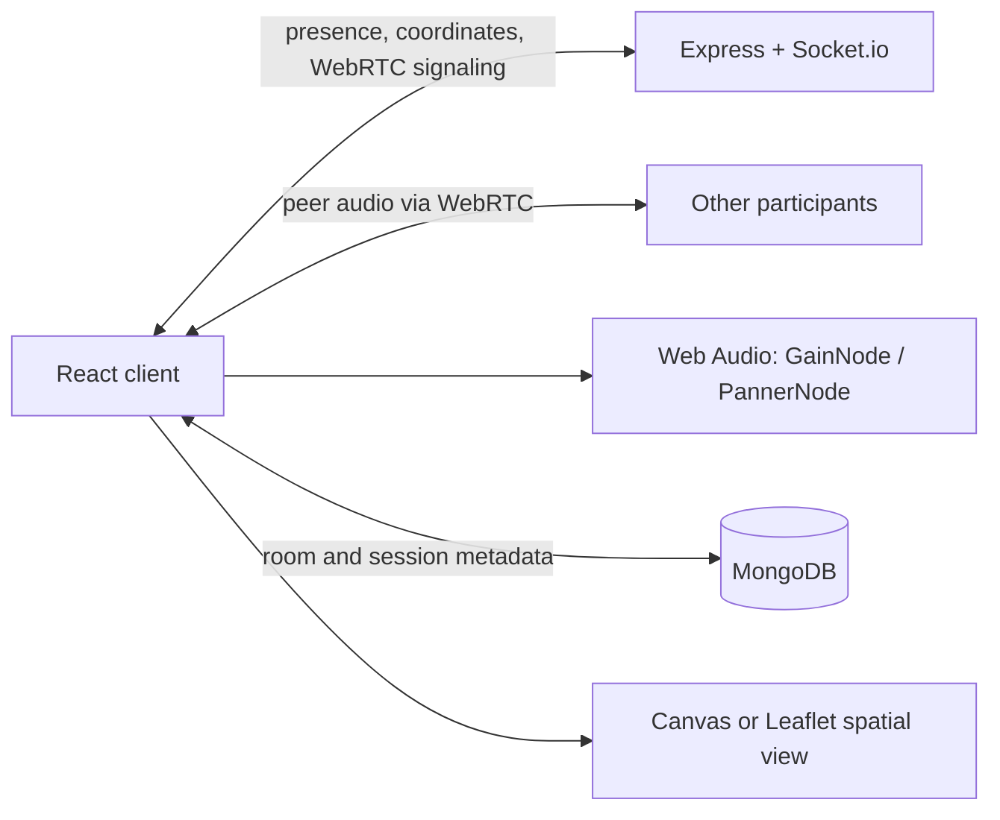

# ProxiSpeak

**ProxiSpeak: Geospatial Proximity Audio Ecosystem** is an internship project for Infotact Solutions.

| Field | Details |
|---|---|
| Reference | ITS/WEB/1213 |
| Role | Associate L1 Intern |
| Domain | Web Development |
| Duration | 10 October 2026 – 10 November 2026 |

## Project overview

ProxiSpeak is a real-time web application where a participant's perceived voice changes with their distance from other participants. Participants can use virtual positions on a 2D canvas, with GPS-based positioning as a possible extension. The app visualizes rooms and participant locations while WebRTC carries peer-to-peer audio.

The first milestone is a reliable virtual-coordinate demo. GPS introduces browser permission, accuracy, and privacy considerations and can be added after the core audio experience works.

## Planned technology

- **Frontend:** React and Tailwind CSS for the responsive room experience and controls.
- **Spatial view:** HTML Canvas for virtual coordinates; Leaflet.js can support a later GPS map mode.
- **Realtime server:** Node.js, Express, and Socket.io for room presence, coordinate updates, and WebRTC signaling.
- **Voice:** WebRTC peer connections for real-time audio.
- **Spatial audio:** Web Audio API `GainNode` for distance-based volume and optional `PannerNode` for directional audio.
- **Persistence:** MongoDB for room and session metadata. Raw audio is not stored.

## Proximity audio model

For virtual positions, use Euclidean distance. For geographic positions, use Haversine distance. Let `d` be the distance between two participants, `d_min` the full-volume range, and `d_max` the audible limit:

```text
gain(d) = 1                                      when d <= d_min
          1 - (d - d_min) / (d_max - d_min)      when d_min < d < d_max
          0                                      when d >= d_max
```

Clamp the result to `[0, 1]` and smooth gain changes to avoid abrupt volume jumps. Each listener applies the gain to each remote participant locally; coordinate changes do not require renegotiating the WebRTC connection.

## Architecture at a glance



## Planned repository layout

```text
client/       React application
server/       Express API and Socket.io signaling
README.md     Project overview and getting started guide
```

This layout is an initial proposal and will evolve as implementation begins.

## Development roadmap

1. **Foundation:** Create the client and server, room UI, virtual map, and synchronized presence.
2. **Voice:** Add microphone controls, WebRTC offer/answer exchange, ICE candidate signaling, and connection states.
3. **Proximity audio:** Calculate distance, visualize audible radii, and apply smoothed gain (and optional panning).
4. **Submission readiness:** Add persistence, hardening, technical documentation, project report, presentation, and a repeatable demo.

## Getting started

Implementation is not yet present in this repository. Once the client and server are added, their package scripts and environment variables will be documented here. At minimum, local development will require a supported Node.js version, MongoDB (local or hosted), and microphone access in a secure browser context (`localhost` is suitable for local development).

## Planned deliverables

- Modular frontend, backend, signaling, and WebRTC source code.
- Technical README and API/event documentation.
- Formal report covering system design, attenuation math, and implementation challenges.
- Presentation slide deck.
- Working demonstration of participant movement modulating remote audio.

## Reference DSA exercise

The internship also covers LeetCode 1385, **Find the Distance Value Between Two Arrays**. The reference implementation uses sorting and binary search (`lower_bound` in C++ and a custom binary search in C) to check whether any value in the other array falls within the absolute-distance threshold `d`.

## License

No license has been selected yet.
