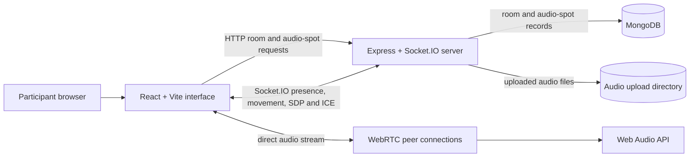
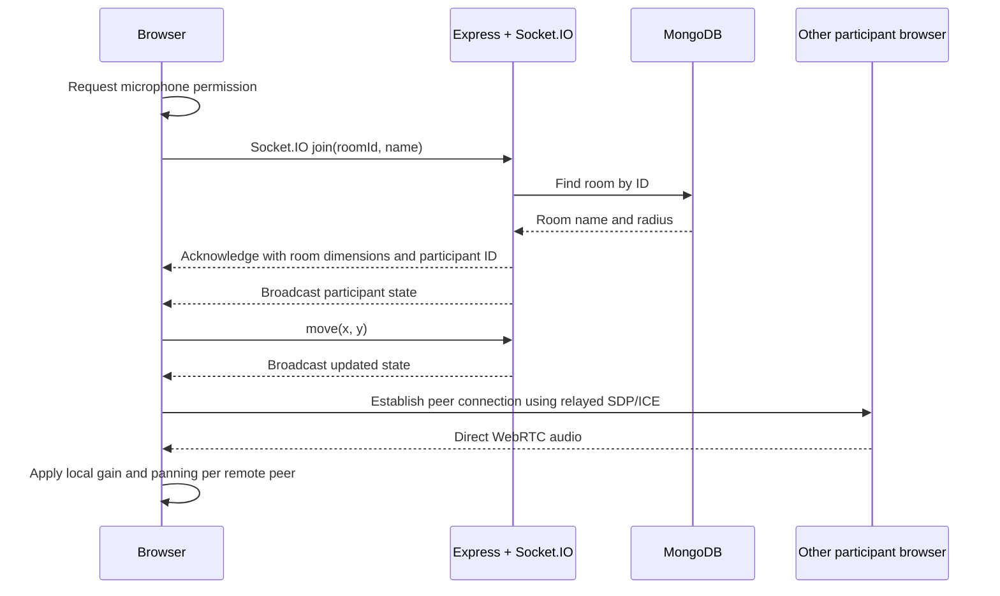

# Application Architecture

This document describes the implementation currently in this repository. The live voice room uses virtual 2D coordinates. The separate audio-spots API stores clips tagged with latitude and longitude; it does not currently place live participants on a GPS map.

## System context



In development, Vite serves the client on port 5173 and proxies API and Socket.IO traffic to Express on port 3000. In production, Express serves the built client and API from the same service. MongoDB holds durable room and audio-spot metadata. Active participants and coordinates are kept in server memory.

## Runtime components

| Component | Responsibility |
|---|---|
| React application (`client/src/App.jsx`) | Room discovery and creation, display name, microphone and room controls, participant list, distance and approximate gain display. |
| Canvas stage (`client/src/Stage.jsx`) | Draws the virtual room and hearing-radius boundaries; handles pointer and keyboard movement. |
| Voice hook (`client/src/useVoice.js`) | Requests microphone access, manages Socket.IO and peer connections, relays WebRTC descriptions/candidates through the server, and applies distance-based gain and spatial panning. |
| Express server (`client/server/server.js`) | HTTP API, static client serving, Socket.IO event handling, in-memory room presence, movement validation and signaling relay. |
| Audio-spots routes (`client/server/routes/audioSpotRoutes.js`) | Validates uploaded audio metadata, saves files, lists/retrieves spots and calculates nearby results. |
| Mongoose models | Persist room and audio-spot metadata in MongoDB. |
| Upload directory | Stores audio files on disk; MongoDB stores each file's generated filename and metadata. |

## Voice-room lifecycle



Joining requires a valid MongoDB room ID and a non-empty display name. Participants begin near the center of a 1200 by 800 virtual canvas. The browser sends movement updates; the server clamps them to canvas bounds and broadcasts the room state. The server forwards signaling only when the sender and recipient share a room. Audio media travels directly between browsers and is not sent through Express or Socket.IO.

Presence is process-local. A disconnect removes the participant from the active room map and broadcasts the remaining state. Restarting the server clears presence but does not remove persisted room records.

## Proximity audio

For listener position `(x₁, y₁)` and remote participant position `(x₂, y₂)`, the client computes Euclidean distance:

```text
d = √((x₂ - x₁)² + (y₂ - y₁)²)
```

The maximum audible radius `R` is configured for the room. The full-volume threshold is `d_min = min(R, max(30, round(0.2 × R)))`. For the implementation's linear falloff:

```text
gain(d) = 1                                      when d ≤ d_min
gain(d) = 1 - (d - d_min) / (R - d_min)         when d_min < d < R
gain(d) = 0                                      when d ≥ R
```

The gain is applied locally through a Web Audio `GainNode` with a short target-time smoothing interval. Optional directional mode uses a `PannerNode` to position sound from relative horizontal and vertical coordinates. A peer connection is created when a participant comes within the room radius and may be closed after they move beyond a small hysteresis margin.

WebRTC uses the configured ICE server list: a public STUN server by default and optional TURN values from the client environment. STUN alone does not guarantee connectivity on restrictive networks.

## HTTP and real-time interfaces

The HTTP API is mounted by Express:

| Method | Path | Purpose |
|---|---|---|
| `GET` | `/api/health` | Reports service and MongoDB connection status. |
| `GET` | `/api/rooms` | Lists up to 100 saved rooms with live participant counts. |
| `POST` | `/api/rooms` | Creates a room; accepts JSON `name` and `radius` (80–600, default 250). |
| `POST` | `/api/audio-spots` | Saves an audio file and location metadata using multipart form data. |
| `GET` | `/api/audio-spots` | Lists recent audio spots. |
| `GET` | `/api/audio-spots/nearby` | Finds spots within `radiusKm` of supplied latitude and longitude using Haversine distance. |
| `GET` | `/api/audio-spots/:id` | Retrieves one audio spot. |

Audio uploads accept supported audio MIME types up to 15 MB. The nearby endpoint scans a bounded set of recent records; a GeoJSON field and MongoDB 2dsphere index are recommended before scaling.

Socket.IO room events:

| Direction | Event | Payload / effect |
|---|---|---|
| Browser → server | `join` | Room ID and display name; acknowledgement returns participant ID, room name, radius, canvas size and marker color. |
| Server → room | `state` | Current member IDs, names, coordinates and colors. |
| Browser → server | `move` | New virtual `x` and `y`; server clamps to the canvas and broadcasts state. |
| Browser → server → peer | `sig` | Target ID and WebRTC SDP or ICE data; server relays only within the same room. |

## Data and trust boundaries

- MongoDB stores room names/radii and audio-spot metadata. Audio bytes are saved in the configured upload directory.
- Socket.IO carries presence, coordinates and signaling only. Live audio is peer-to-peer when ICE negotiation succeeds.
- Coordinates for the voice room are virtual canvas positions; the current voice room does not request GPS.
- The service has no account system or room authorization. Room IDs and display names are not authentication.
- Signaling, room membership and coordinates are held in one server process. Multi-instance deployment would need shared presence (for example, a Socket.IO adapter and external state store).
- Uploaded file type is checked from the request MIME type and size; that alone does not verify file contents.

## Repository map

```text
client/
├── src/
│   ├── App.jsx              # Room discovery and controls
│   ├── Stage.jsx            # Canvas map and movement
│   ├── useVoice.js          # Socket.IO, WebRTC and Web Audio
│   └── index.css            # UI styles and design tokens
├── server/
│   ├── config/db.js         # MongoDB connection
│   ├── models/              # Room and AudioSpot schemas
│   ├── routes/              # Audio-spots HTTP API
│   └── server.js            # Express and Socket.IO entry point
├── uploads/                 # Runtime audio files
└── vite.config.mjs          # Development proxy and Vite configuration
docs/
└── ARCHITECTURE.md          # This guide
```

## Local run

1. Install Node.js 18 or newer and run MongoDB locally or provide a MongoDB Atlas URI.
2. From `client/`, copy `.env.example` to `.env` and set `MONGO_URI` if needed.
3. Run `npm install`, then `npm run dev`.
4. Open `http://localhost:5173`, grant microphone permission, and join the same room in two browser windows. Headphones help avoid feedback.
5. For a production build, run `npm run build` and then `npm start` from `client/`.

The separate setup and user overview remain in the [README](../README.md).
